<picture>
  <source media="(prefers-color-scheme: dark)" srcset="assets/a-terminal-dark.svg">
  
</picture>

# Hey, I'm Amir

Cybersecurity student at **Penn State University Park**, class of 2028, working where AI and security meet. I build AI agents and LLM apps and work on keeping them safe: what they may do, what they must never see, and how they handle text written to manipulate them. The other half of my time is classic offensive security: breaking web apps and networks in the lab.

Looking for a **summer 2027 internship** in AI security, application security or offensive security.

### What I'm working on

**[Koob](https://github.com/Samitovamir/koob)** — a macOS assistant that lives in the MacBook notch: it talks, sees the screen, works other apps with mouse and keyboard, and remembers. The part I care most about is the safety gate: one function decides every tool call, foreign text is data and never instructions, and secrets never reach the model.

`Python` `Claude Agent SDK` `MCP` `SQLite` `Swift`

**[RedLava](https://github.com/Samitovamir/RedLava)** — training and health dashboard for a triathlon club: Garmin, WHOOP, calendar and blood tests in one place, with a Claude assistant that works from the athlete's own data. Other people's text reaches the model as labelled data, moving or deleting events needs a human tap, and CodeQL and gitleaks run on every push. [Live demo](https://redlava-demo-website.vercel.app) (`guest` / `123`)

`React` `Express` `Vercel` `Claude API` `OAuth 2.0`

**Pentest reference** — my offline notebook: about 110 notes in 12 categories and seven step-by-step workflows, searchable mid-lab without internet.

`Kali` `nmap` `Burp Suite` `Wireshark` `Metasploit`

**Conference platform** — five-person team project; I owned proposal submission and admin approval end to end, React on a Node/Express REST backend.

`JavaScript` `React` `Node.js` `Express`

### Tools

**AI:** Claude API, Agent SDK, MCP, prompt-injection defense, Ollama · **Languages:** Python, JavaScript, Bash · **Web:** React, Node.js, Express, FastAPI · **Security:** Kali, nmap, Burp Suite, Wireshark, Metasploit, CodeQL

Studying for the eJPT. Long term: my own security consulting business. · aps7692@psu.edu
